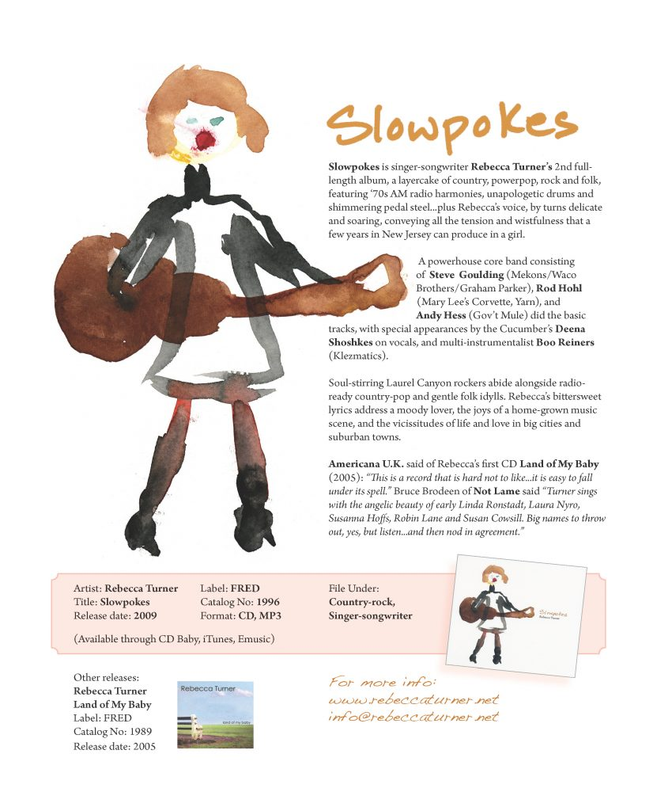
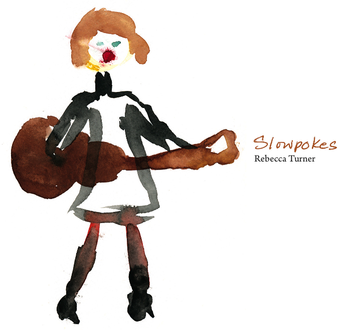
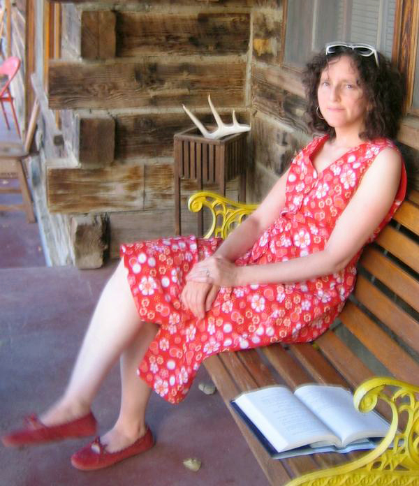

<figure class="wp-block-image alignfull"></figure>

## **&#8230;Rebecca Turner press kit**

**Short bio:**

Rebecca Turner&#8217;s music is a beat-up valise full of Laurel Canyon postcards, filled out with New York citygirl musings and country car-radio anthems. Her novelistic folk-rock is full of vivid imagery, happy/sad chords and unusual melodies that delight. Her soprano voice rings clear when surrounded by the sounds she grew up with in &#8217;70s LA: jangly guitars, soaring pedal steel, dancing mandolin, and tight vocal harmonies; yet her songs possess a contemporary, quirky sensibility.

Since 2007 Rebecca with Deena Shoshkes (of The Cucumbers) have been hosting the Saturday Afternoon Song Swap, a gathering of NJ and NY area songwriters. Assembling once a month to share songs and stories with an ever-growing audience, the Swap has become a close-knit yet ever-expanding community that she&#8217;s wildly proud of.

Performing solo or with a stage-full of her talented friends, at house concerts or on street-corners, in coffee bars or clubs, for kids and for grownups, Rebecca brings the audience along on a musical road-trip up the coast; soaring to an upbeat song, or drawing in close to watch the sun set together.

**https://rebeccaturner.net**

**Booking &#8211;&nbsp;<rebeccamo34@gmail.com>**

    

        <figure class="wp-block-image">
            <figcaption>Slowpokes album onesheet  download&nbsp;<a href="/images/r_turner_onesheet.pdf">pdf version</a>,&nbsp;<a href="/images/r_turner_onesheet.jpg">jpg version</a></figcaption>
        </figure>
    

    

        <figure class="wp-block-image">
            <figcaption>blank Slowpokes gig poster download&nbsp;<a href="/images/rt_poster_slowpokes.pdf">pdf version</a>,&nbsp;<a href="/images/rt_poster_slowpokes.jpg">jpg version</a></figcaption>
        </figure>
    

    

        <figure class="wp-block-image">
            <figcaption>photo of Rebecca in Pioneertown, CA download&nbsp;<a href="/images/pioneer.jpg">jpg version</a></figcaption>
        </figure>
    

    

        <figure class="wp-block-image">
            <figcaption>photo of Rebecca in the studio download&nbsp;<a href="/images/studio.jpg">jpg version</a></figcaption>
        </figure>
    

