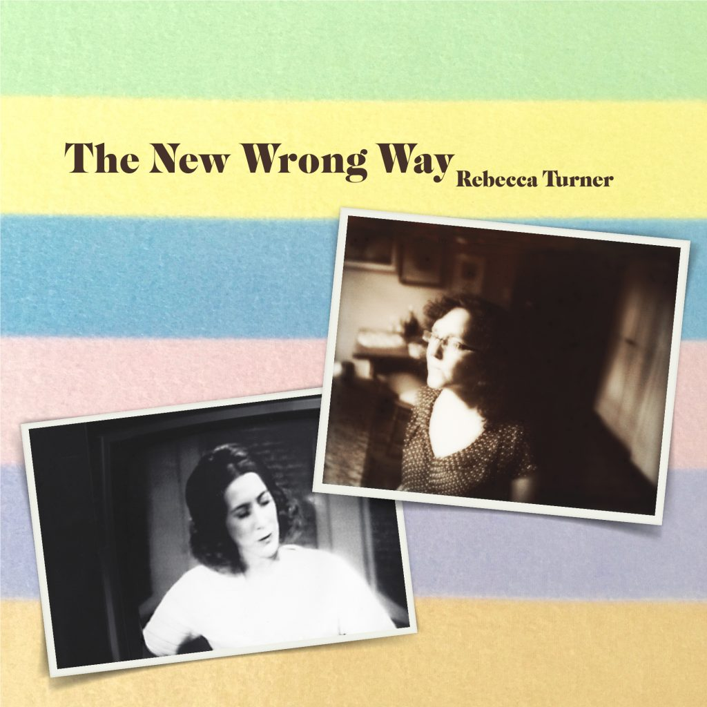
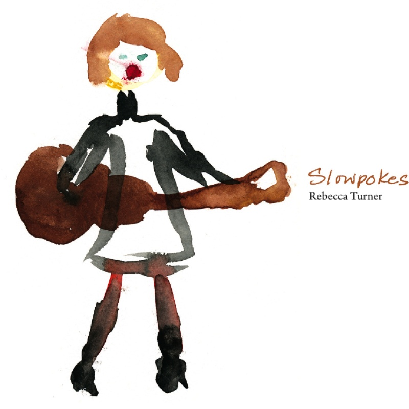
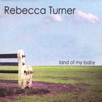

<figure class="wp-block-image is-resized"></figure>

**The New Wrong Way**
&nbsp;&nbsp;&nbsp;&nbsp;NJ Arts &#8211; “&#8230;sophisticated, eclectic songs address issues of aging, perseverance, independence and self-awareness&#8230;poetic words create vivid character portraits delivered with a beautiful, delicate and nuanced voice&#8230;imbued with an appreciation of the impact of music on both performers and people who listen intensely.”
&nbsp;&nbsp;&nbsp;&nbsp;Musikbloggen67 &#8211; &#8220;Another fantastic singer that I think is a bit like Emmylou Harris and a bit like Sheryl Crow. Simple and straightforward but beautiful in an even and easily accessible way.&#8221;
&nbsp;&nbsp;&nbsp;&nbsp;Popmatters &#8211; &#8220;A remarkably cohesive set that is both contemplative and uplifting, The New Wrong Way is evidence that Turner remains as strong a writer as ever and maybe has even become a more accomplished one&#8221;
&nbsp;&nbsp;&nbsp;&nbsp;Colorado Springs Independent &#8211; &#8220;Rebecca Turner’s unique delivery might be an acquired taste in timbre a la Victoria Williams, but the exceptional lyrics and arrangements in The New Wrong Way (Rebecca Turner) should win over a new roster of fans. Turner’s two albums in the early 2000s were well accepted, but this is her first album in a decade, and arguably her finest.&#8221;
&nbsp;&nbsp;&nbsp;&nbsp;Seattle Post Intelligencer &#8211; &#8220;It was worth the wait for this record, which sounds redolent of early &#8217;70s West Coast folk/rock. (Imagine a much more upbeat Judee Sill and you won&#8217;t be far off.) Jingle-jangle guitar is predominant in the backup, but there&#8217;s also enough pedal steel-and, on one track, banjo-to suggest a penchant for country.&#8221;
&nbsp;&nbsp;&nbsp;&nbsp;Culture Sonar &#8211; &#8220;&#8230;songs whose easy tunefulness can almost make you forget how much meat is really on their bones.&#8221;
&nbsp;&nbsp;&nbsp;&nbsp;Take Effect Reviews &#8211; &#8220;Turner brings a vast amount of influences to her first album in a decade and even more skill. An extremely poetic and thoughtful record, her kind of rootsy and mostly diverse Americana formula just might make her your new favorite singer-songwriter.&#8221;
&nbsp;&nbsp;&nbsp;&nbsp;Anearful &#8211; “She manages to find deeply personal little details and turn them into songs so relatable you&#8217;ll think these things happened to you.”

<figure class="wp-block-image is-resized">
</figure>

**Slowpokes**
&nbsp;&nbsp;&nbsp;&nbsp;&nbsp;&nbsp;&nbsp; Beat Surrender &#8211; &#8220;Slowpokes has plenty of sweet vocals, sparkling strings and West Coast warmth to raise the temperature.&#8221;&nbsp;
&nbsp;&nbsp;&nbsp;&nbsp;&nbsp;&nbsp;&nbsp; Americana U.K. &#8211; &#8220;&#8230;sounds like it has soaked up a lot of sun, and this translates to a warmth of sound and intention that is very endearing.&#8221;&nbsp;
&nbsp;&nbsp;&nbsp;&nbsp;&nbsp;&nbsp;&nbsp; Jersey Beat / The World According to Wawrzyniak &#8211; &#8220;Turner has a fine knack for crafting lyrics that are sharp and thoughtful&#8230;A very nice little jewel.&#8221;&nbsp;
&nbsp;&nbsp;&nbsp;&nbsp;&nbsp;&nbsp;&nbsp; All Music Guide &#8211; &#8220;Turner&#8217;s lyrics deal in subtle emotional shadings that mix the moody and the hopeful&#8230;&#8221;&nbsp;<figure class="wp-block-image is-resized">

<figure></figure>

**&nbsp;&nbsp;Land Of My Baby**
&nbsp;&nbsp;&nbsp;&nbsp;&nbsp;&nbsp;&nbsp; Americana U.K. &#8211; &#8220;&#8230;so charmingly is it done that it is easy to fall under its spell.&#8221;&nbsp;

&nbsp;&nbsp;&nbsp;&nbsp;&nbsp;&nbsp;&nbsp; U.S. promotion by <a href="http://www.howlinwuelf.com/clients/rebecca-turner/" target="blank" rel="noopener noreferrer">Howard Wuelf | Howlin&#8217; Wuelf Media</a>.
&nbsp;&nbsp;&nbsp;&nbsp;&nbsp;&nbsp;&nbsp; European promotion by <a href="https://www.hemifran.com/artist/Rebecca%20Turner/" target="blank" rel="noopener noreferrer">Peter Holmstedt | Hemifrån</a>.
